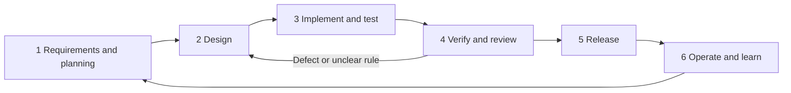

# Engineering documentation: start here

For this two-developer project, use **six repeating lifecycle phases and seven core documents**. This is our working convention, not a required number for every software team. The useful property is that each decision has one owner document and can be followed through to verification.

## 1. The six phases

| Phase | Question to answer | Work and evidence | Ready to move on when |
|---|---|---|---|
| 1. Requirements and planning | What problem are we solving, for whom, and what counts as success? | Select a product requirement, acceptance example, owner and milestone. | Both developers understand one small deliverable and its limits. |
| 2. Design | How will it work, and what do callers expect? | Update architecture only if affected; agree on the contract, module/function responsibilities and test scenarios. | Inputs, outputs, failure behavior and relevant open decisions are settled for this deliverable. |
| 3. Implementation | Can we make one agreed behavior work? | Write a focused failing test, implement it, then repeat for the next behavior. | Code and tests cover the agreed slice; current local checks pass. |
| 4. Verification and review | Does the integrated change meet its requirements? | Run related/full checks, integration/manual evidence and teammate review. | Acceptance passes, required CI passes and the other developer approves. |
| 5. Release | Can we deploy and recover this revision? | Rehearse migrations, deploy a known revision, run smoke checks, record results. | The release evidence and compatible recovery steps are recorded. |
| 6. Operation and maintenance | What did real usage reveal? | Investigate defects/feedback, add regression evidence and select the next improvement. | The issue is resolved or becomes a clearly owned item for the next loop. |

Design the tests in phase 2, write/run them during phase 3, and broaden evidence in phase 4. These phases overlap: do not finish all design documents or all tests for the entire game before implementing a useful slice. [AWS's SDLC overview](https://aws.amazon.com/what-is/sdlc/) describes lifecycle work; our grouping combines planning and requirements for this small team.



## 2. The seven core documents

| Document | It owns | It does not own | Author and reviewer |
|---|---|---|---|
| [Product requirements](specs/product.md) | User needs, scope, game rules, acceptance and requirement IDs. | HTTP field names or internal functions. | Feature owner; other developer reviews. |
| [High-level design (HLD)](specs/design.md) | Major parts, data flow, technology decisions and architectural limits. | Detailed error tables or individual test cases. | API lead; browser lead reviews. |
| [Low-level design (LLD)](specs/lld.md) | Modules, proposed functions, inputs/outputs, dependencies, schema, state transitions and screen responsibilities. | A second copy of public contracts or the test catalog. | Owner of the affected module; other developer reviews. |
| [API and behavior contracts](specs/contracts.md) | Request/response fields, validation, error codes, externally observable guarantees, events and unresolved contract decisions. | Function bodies or test implementations. | API and browser developers agree together. |
| [Test specification](testing/test-spec.md) | Test strategy, cases, preconditions, actions, expected results and requirement-to-test mapping. | New product rules inferred from current code. | Feature author; reviewer challenges missing cases. |
| [Implementation plan](delivery/implementation-plan.md) | Dependency order, milestones, ownership and acceptance gates. | Requirements redefined to match task progress. | Both developers maintain it. |
| [Quality and release guide](delivery/quality-and-release.md) | Local/CI checks, merge gates, release procedure and maintenance evidence. | Claims that unconfigured automation or unrun releases passed. | Release owner; teammate verifies. |

**How many files in total?** Seven core engineering documents, plus four navigation/team-learning files: the root README, CONTRIBUTING, this index, and the optional testing learning guide. Diagrams support the HLD. You do not need seven new documents per feature: edit the relevant sections of these living documents.

```text
README.md                         Setup and observed implementation status
CONTRIBUTING.md                   Git, commits, reviews and teamwork
docs/
  README.md                      This lifecycle and document map
  specs/
    product.md                   WHY / WHAT
    design.md                    HIGH-LEVEL HOW
    lld.md                       DETAILED HOW / FUNCTIONS
    contracts.md                 CALLER AGREEMENT / EXPECTED BEHAVIOR
    diagrams/                    Conceptual ERD source and export
  testing/
    test-spec.md                 WHAT TO TEST / EXPECTED RESULTS
    learning-guide.md            Optional exercises, not a second spec
  delivery/
    implementation-plan.md       ORDER / OWNER / DEPENDENCIES
    quality-and-release.md       VERIFY / SHIP / RECOVER / MAINTAIN
```

## 3. How a requirement reaches a test

Use this chain for each meaningful behavior:

**Product requirement → public contract → LLD function → test case and expected result → recorded run/review evidence.**

Example for this project's current work:

| Step | Where to look | Concrete item |
|---|---|---|
| Need | Product PR-01 | The host can create and share a lobby. |
| Agreement | Contracts CG-01 / CG-07 | Valid creation returns a persisted lobby; an invalid name produces `422 VALIDATION_ERROR`. |
| Implementation responsibility | LLD `createGame` and create request schema | Normalize/validate input and create the game/host session. Names are proposed until implemented. |
| Test | Test specification `games.create` | Given a valid interval and a blank name, submit create; expect the validation error. |
| Evidence | Feature PR | Exact command, actual failure/pass, revision and reviewer. No evidence is claimed by the specification itself. |

The traceability table belongs in the test specification. Do not make another spreadsheet with the same map. Linking requirements to tests helps assess change impact; this lightweight practice is inspired by [NASA's requirements/test traceability guidance](https://swehb.nasa.gov/spaces/SWEHBVB/pages/32604549/SWE-072%2B-%2BBidirectional%2BTraceability%2BBetween%2BSoftware%2BTest%2BProcedures%2Band%2BSoftware%2BRequirements), not an adoption of NASA's full process.

## 4. What to read for your next change

1. Find the product requirement and relevant delivery task.
2. Read its contract; resolve only the open decisions affecting that behavior.
3. Read its proposed LLD function, dependencies and side effects.
4. Select the corresponding test-spec row. Describe its setup, action and expected result in your own words.
5. Write the test and application code yourself, one behavior at a time.
6. Run the quality checks and request the other developer's review.

**Start now with PR-01:** contracts sections 2–4, LLD section 10, and the create-game section of the test specification. Your existing test file is the starting point. Do not create the planned functions or suites merely to fill the directory tree.

## 5. Document changes and approval

Use **Draft → Agreed → Implemented → Verified** at the feature/requirement level, with **Needs decision** where behavior is unresolved. A document can contain an agreed create-game rule and a pending reconnect rule; do not label the entire document implemented because one feature works. Earlier “approved design” labels describe the original direction, not complete agreement on every detail.

For each PR, identify the requirement and the authoritative documents it changes. One author and one approving reviewer are sufficient for this two-person team. Proposed internal function names can change during implementation; update the LLD without rewriting tests that still exercise the same public behavior.

| If this changes… | Update… |
|---|---|
| User rule or scope | Product, then affected contract, LLD and test cases. |
| Wire fields, status or event payload | Contracts, affected client/server implementation, schemas and tests. |
| Internal module/function layout | LLD and implementation; public tests stay stable where behavior is unchanged. |
| A discovered edge case | Agree on the outcome in the contract, then add test evidence. |
| Tooling or deployment | Quality/release guide, affected config and setup notes. |
| Implementation status | PR/issue evidence and root README; don't copy run counts into every spec. |

If documents conflict, do not pick whichever is convenient. The product owns intent, contracts own public outcomes, LLD owns internal responsibility and the test spec owns verification. Record and resolve the conflict in the owning document before implementing that affected behavior.

Create a separate architecture decision record only when a significant choice needs alternatives and rationale that no longer fit the HLD. Create an operational runbook per service only when separate operations justify it. No additional document is required just to look professional.
