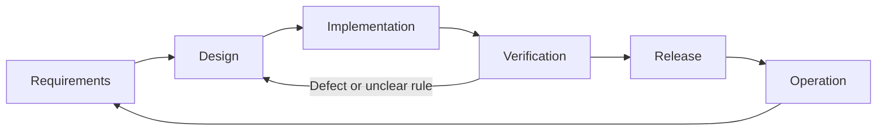

# Engineering documentation

This directory contains the authoritative product, design, contract, testing and delivery documentation for Carpool Quiz League. Each decision should be defined once and referenced from dependent documents.

## Software lifecycle

| Phase | Purpose | Primary evidence |
|---|---|---|
| Requirements and planning | Define the user problem, scope and acceptance criteria. | Product requirement and delivery milestone. |
| Design | Define architecture, public contracts, module responsibilities and test scenarios. | HLD, LLD, API contract and test specification. |
| Implementation | Deliver one agreed behavior at a time using test-driven development. | Code, migrations and focused automated tests. |
| Verification and review | Confirm the integrated change satisfies its requirements. | Test results, CI, manual evidence and review. |
| Release | Deploy a known revision and verify recovery procedures. | Migration, deployment, smoke-test and recovery records. |
| Operation and maintenance | Resolve production defects and incorporate feedback. | Incident records, regression tests and follow-up requirements. |



## Document set

| Document | Defines | Excludes |
|---|---|---|
| [Product requirements](specs/product.md) | User needs, scope, game rules, acceptance criteria and requirement IDs. | HTTP fields and internal implementation details. |
| [High-level design](specs/design.md) | System components, data flow, technology choices and architectural constraints. | Route-level errors and individual test cases. |
| [Low-level design](specs/lld.md) | Modules, interfaces, data schema, state transitions and screen responsibilities. | Duplicate public contracts and test catalogs. |
| [API and behavior contracts](specs/contracts.md) | Requests, responses, validation, errors, observable guarantees and events. | Function bodies and test implementations. |
| [Test specification](testing/test-spec.md) | Test strategy, cases, preconditions, actions and expected outcomes. | New product rules not defined by requirements or contracts. |
| [Implementation plan](delivery/implementation-plan.md) | Dependency order, milestones and acceptance gates. | Redefinitions of product or API behavior. |
| [Quality and release guide](delivery/quality-and-release.md) | Local checks, CI gates, release procedure and maintenance evidence. | Claims unsupported by executed checks. |

## Repository map

```text
README.md                         Project overview, setup and commands
CONTRIBUTING.md                   Branch, review and commit workflow
docs/
  README.md                       Documentation index and governance
  specs/
    product.md                    Product requirements
    design.md                     High-level design
    lld.md                        Low-level design
    contracts.md                  API and behavior contracts
    diagrams/                     Editable diagram sources and exports
  testing/
    test-spec.md                  Test strategy and acceptance catalog
  delivery/
    implementation-plan.md        Delivery sequence and dependencies
    quality-and-release.md        Verification, release and maintenance
```

## Traceability

Every implemented behavior follows this chain:

```text
Product requirement
  → public contract
  → LLD responsibility
  → test case and expected result
  → implementation
  → verification evidence
```

The [test specification](testing/test-spec.md) maintains requirement-to-test mappings. Pull requests record the revision-specific commands and results; specifications define expected behavior without duplicating progress logs.

## Change governance

| Change | Documents to update |
|---|---|
| User rule or scope | Product requirements, followed by affected contracts, design and tests. |
| Request, response, status or event payload | Contracts, shared schemas, affected consumers and tests. |
| Internal module or function structure | LLD and implementation. Public tests remain unchanged when behavior is unchanged. |
| New edge case | Contract decision followed by test evidence. |
| Tooling, CI or deployment | Quality and release guide plus affected configuration. |

When documents conflict, product requirements define intent, contracts define public outcomes, the LLD defines internal responsibilities and the test specification defines verification. Resolve the conflict in the authoritative document before implementation.

Create an architecture decision record only when a significant decision and its alternatives no longer fit clearly in the high-level design. Create an operational runbook only when a deployed service requires procedures beyond the shared quality and release guide.
