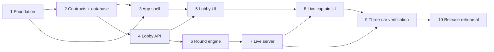

# Carpool Quiz League Implementation Plan

**Document role:** Delivery milestones and dependency order. See the [engineering document map](../README.md) for the six lifecycle phases and the authoritative specification for each decision. These ten milestones are not ten SDLC phases.

**Goal:** Deliver the Carpool Quiz League MVP in small, reviewable changes.

**Progress note (2026-10-09):** The MVP backend, settled live synchronization, passenger gameplay/recovery/lifecycle controls, browser acceptance and local production rehearsal are implemented and reviewed. Local October 8 evidence covers 195 ordinary tests, 15 PostgreSQL scenarios, migration safety, three browser tests and built-container restart/backup/restore; see the [dated browser checklist](../testing/manual-three-car-checklist.md), [release evidence](quality-and-release.md#7-release-rehearsal-and-execution) and [runbook](production-runbook.md). The [hosted PR verify run](https://github.com/pattarapolj/carpool-gaming/actions/runs/37885006560) passed at `87472fc`; any subsequent head still requires its own hosted checks and scoped review. Main protection remains unavailable for the current private repository (API 403 requires GitHub Pro or public visibility); no settings were changed. Public hosting and physical-phone/PWA/cellular acceptance remain unperformed, and temporary Docker recovery does not establish permanent host repair. See [CONTRIBUTING](../../CONTRIBUTING.md) for the branch workflow.

The tasks are milestones, not mandatory PR sizes. Deliver one reviewable behavior per PR; a large milestone can take several PRs. Write tests for the next behavior and implement it before expanding to the next. Use the contract decision register before committing to an ambiguous contract.

**Architecture:** A React PWA calls one Fastify/Socket.IO backend, backed by PostgreSQL. [HLD](../specs/design.md) owns architectural choices; [LLD](../specs/lld.md) owns functions/schema; [contracts](../specs/contracts.md) own observable behavior; [test specification](../testing/test-spec.md) owns cases and expected results. This file owns sequencing.

**Tech Stack:** Node.js 22 LTS, TypeScript, pnpm workspace, React 19 + Vite + `vite-plugin-pwa`, Fastify, Socket.IO, PostgreSQL 16, `pg`, Zod, Vitest, Docker Compose.

**Spec:** `docs/specs/product.md`  
**LLD:** `docs/specs/lld.md`  
**CI guide:** `docs/delivery/quality-and-release.md`

## Global constraints

- Read the high-level design and LLD before starting any task.
- Preserve server-authoritative timing, scoring, answer locking, and reveal behavior.
- Keep the driver out of the app’s interaction model.
- A shared contract change in `packages/contracts` requires an approving review.
- One reviewable behavior equals one branch, one pull request, and one focused commit series; milestones may span several such changes.
- Do not merge until the checks in the CI guide pass.

---

## Delivery order

### Task 1: Foundation

**Files:** Root workspace files; `apps/api` and `apps/web` starter projects; `.github/workflows/ci.yml`.  
**Depends on:** None.  
**LLD reference:** §§2–3; CI guide §4.

- [ ] Create the Node 22 pnpm workspace, API project, web project, Docker PostgreSQL service, and CI workflow.
- [ ] Add `GET /health` and its failing-then-passing Fastify inject test.
- [ ] Confirm `pnpm test`, `pnpm lint`, `pnpm typecheck`, and `pnpm build` work locally.
- [ ] Commit `chore: create game workspace`.

**Done when:** a fresh clone can start PostgreSQL, run the health test, and execute the GitHub Actions commands.

### Task 2: Shared contracts and database

**Files:** `packages/contracts`, `apps/api/migrations/001_initial.sql`, `apps/api/src/db.ts`, database tests.  
**Depends on:** Task 1.  
**References:** LLD §§3-4 and 10; contracts common errors and §9 events.

- [ ] Define shared request, response, view and event schemas as each dependent feature needs them; do not scaffold the complete future contract package at once.
- [ ] Add migrations and constraints needed by each feature; complete the five-table schema by the round-engine milestone.
- [ ] Add a question seed fixture containing one example of each question type.
- [ ] Prove database duplicate-answer protection with an integration test.
- [ ] Commit `feat: add game contracts and schema`.

**Done when:** delivered contracts compile in their consumers and real database tests prove their constraints. This milestone grows with dependent features; the complete round schema must reject duplicate `(round_id, car_team_id)` answers before Task 6 completes. Lobby work can begin once its own contracts/schema are verified.

### Task 3: Captain app shell

**Files:** `apps/web/src/App.tsx`, `screens/`, `styles.css`, mock state, component tests.  
**Depends on:** Task 1 and the screen contracts from Task 2.  
**References:** LLD §§8 and 10; contracts §9 events and §10 synchronization decisions.

- [x] Build Welcome, Lobby, Question, Locked, Results, and Reconnecting screens (production snapshots; contract fixtures in tests).
- [x] Add semantic controls, visible focus, contrast, and 48px minimum touch targets.
- [x] Add a component test for an open round’s prompt and answer controls.
- [ ] Check all screens at a phone-sized viewport.
- [ ] Commit `feat: add captain app shell`.

**Done when:** every LLD screen has a renderable component, and the open-round component test passes.

### Task 4: Game lobby API and sessions

**Files:** `auth.ts`, `game-service.ts`, `routes/games.ts`, API tests.  
**Depends on:** Task 2.  
**References:** Contracts §§2-4 and 8; LLD §10 lobby functions.

- [ ] Implement opaque host/captain tokens and hashed token storage.
- [ ] Implement create, join, start, snapshot, and leave routes with the documented response and error envelopes.
- [ ] Test all route acceptance criteria from the API contract, including no answer-key leakage through an open-round snapshot.
- [ ] Commit `feat: add lobby game API`.

**Done when:** every API-contract acceptance statement for these five routes has a passing API/database test.

### Task 5: Create, join, and lobby UI

**Files:** `api.ts`, `session.ts`, create/join/host/captain lobby screens, component tests.  
**Depends on:** Tasks 3 and 4.  
**LLD reference:** §8 Welcome through Captain lobby.

- [ ] Connect forms to Task 4 routes and persist only opaque session tokens plus game ID.
- [ ] Render host-only start controls and captain-only waiting controls.
- [ ] Surface invalid name/code and network errors inline without losing entered text.
- [ ] Test create-game request defaults and join-code validation.
- [ ] Commit `feat: add game lobby screens`.

**Done when:** three browser profiles can create a host and join two car teams through the real API.

### Task 6: Round engine and answer endpoint

**Files:** `round-service.ts`, `routes/rounds.ts`, round tests.  
**Depends on:** Task 4.  
**References:** LLD §§4-5 and 10; contracts §8 answer operation.

- [ ] Implement fixed scheduling, 60-second deadlines, expected-team capture, answer locking, and transaction-based scoring.
- [ ] Implement the submit-answer route with captain ownership, choice validation, deadline handling, and `409` duplicate behavior.
- [ ] Unit test multiple choice, true/false, estimate ties, wrong-team access, expiration, and duplicate attempts.
- [ ] Commit `feat: add authoritative round scoring`.

**Done when:** all scoring rules and answer-route criteria in LLD §5 and contracts §8 have passing tests.

### Task 7: Coordinator and Socket.IO server

**Files:** `coordinator.ts`, `realtime.ts`, coordinator/socket tests.  
**Depends on:** Task 6.  
**References:** LLD §§5 and 10; contracts §9 live events and §10 decisions.

- [ ] Add the one-second coordinator tick and expose a deterministic tick function for tests.
- [ ] Add authenticated game rooms, subscription, and the exact event payloads from the contract package.
- [ ] Broadcast only after the corresponding database transaction commits.
- [ ] Test immediate first round, deadline reveal, all-answers early reveal, one reveal only, and invalid socket token rejection.
- [ ] Commit `feat: add game realtime events`.

**Done when:** two connected test sockets receive the expected event sequence and never receive an answer key before reveal.

### Task 8: Live captain gameplay and reconnect

**Files:** `realtime.ts`, `useGameSnapshot.ts`, question/locked/results/reconnect screens and tests.  
**Depends on:** Tasks 5 and 7.  
**References:** LLD §§8 and 10; contracts §9 events and §10 synchronization decisions.

- [x] Use typed authoritative snapshots; Socket.IO events invalidate serialized reads instead of overwriting partial state (approved synchronization protocol).
- [x] Submit exactly one selected answer with separate confirmation; successful confirmation/stored own answer locks controls, while busy requests temporarily disable them.
- [x] Implement the approved subscription-before-snapshot protocol, dirty buffering, bounded acknowledgement timeout, session/connection epochs and 15-second reconciliation.
- [x] Test `round.started`, `answer.locked`, `round.revealed`, completion and reconnect state transitions, lost answer responses and explicit lifecycle controls.
- [x] Commit `feat: add live captain gameplay`.

Component verification, fresh Task 8 review and historical hosted CI passed. Task 9 added actual multi-context Chromium acceptance; physical phone/installed-PWA/cellular checks remain separate gates.

**Done when:** refreshing a question, locked, and results screen restores the correct server state and never exposes a pre-reveal answer key.

### Task 9: Three-car acceptance verification

Delivered at `ec7b081`: two real Chromium journeys (host/three cars, recovery/reveal/lifecycle; final-slot/two-hour boundary) plus the cleanup failure-path check. The [dated checklist](../testing/manual-three-car-checklist.md) records desktop viewport evidence and explicit physical-phone/PWA/cellular limitations. Fresh task review and [historical hosted CI](https://github.com/pattarapolj/carpool-gaming/actions/runs/37753549147) passed. Final review accepted the existing cap/no-fit `nextRoundAt` boundary behavior; contracts section 8 clarifies that it can represent final waiting/completion rather than another playable question.

### Task 10: Production rehearsal

**Files:** root Dockerfile/Compose/env, API bootstrap/migration runner, release tests, [runbook](production-runbook.md), quality guide and README.

- [x] Validate database URL, port, exact production origin and available built assets before listening.
- [x] Serve built PWA/API/Socket.IO from one unprivileged process; retain development Vite proxy.
- [x] Apply ordered migrations with transactional journal/checksums/advisory locking; explicitly verify legacy adoption and seed idempotently.
- [x] Reject untrusted browser origins across HTTP and both live transports while retaining authenticated native clients.
- [x] Run a real two-car game against built containers, preserve its locked answer across restart and reconnect automatically.
- [x] Rehearse legacy003 adoption/upgrades and pg_dump/restore into a separate runnable disposable project with stored game/answer evidence.
- [x] Document fresh install, adoption, upgrades, health, backup/restore, compatible recovery, HTTPS proxy and single-process limit.

Local rehearsal and scoped/broad review are complete; [hosted PR checks](https://github.com/pattarapolj/carpool-gaming/actions/runs/37885006560) passed at `87472fc`. Subsequent heads require their own hosted checks and scoped review. No public target/deployment, DNS changes, physical-device acceptance, automatic merge, permanent Docker-host repair or enforced private-repository protection is claimed.

## Pull-request checklist

- [ ] The branch implements one reviewable behavior or tightly related defect fix and links its product requirement.
- [ ] Tests were added/updated for the behavior changed.
- [ ] Focused test, full test suite, lint and type check passed locally; build also passed once implemented (required to complete Foundation).
- [ ] LLD/API/event contract changes receive an approving review.
- [ ] GitHub Actions `verify` job is green.
- [ ] The pull request is approved.
