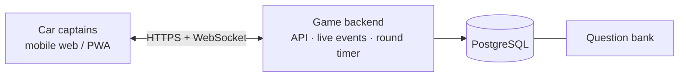
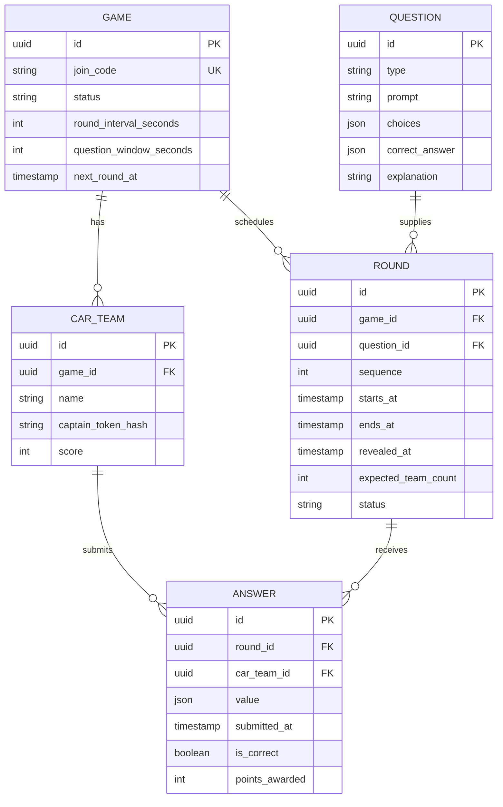
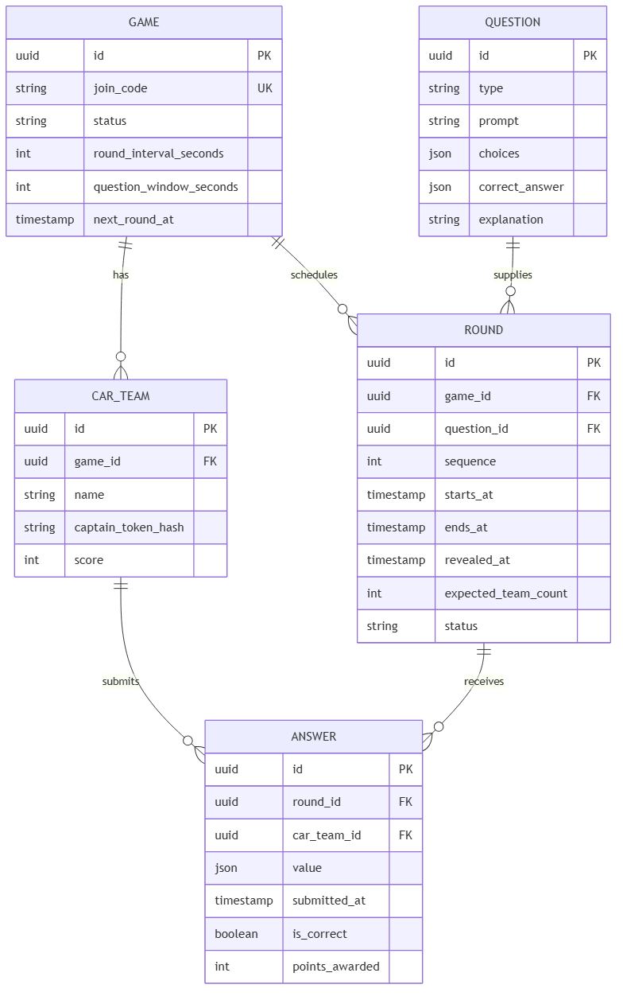

# High-level design

**Behavior amendment:** [Two-phone gameplay (2026-10-09)](../delivery/two-phone-gameplay.md) supersedes this document's spectator-host and fixed-wait rules.

**Status:** Proposed implementation architecture based on the existing MVP design; no new deployment is claimed.
**Purpose:** Explain the major parts, their responsibilities and the reasons for the technical choices. Product requirements live in [product.md](product.md); detailed functions and schema live in [lld.md](lld.md); public behavior lives in [contracts.md](contracts.md).

## 1. Architecture

Version 1 is a modular monolith: one mobile-first Progressive Web App (PWA), one TypeScript backend service, and one PostgreSQL database. This avoids the operational complexity of microservices while keeping timing and scoring authoritative.

### Responsibilities

| Component | Responsibility |
|---|---|
| PWA client | Presents game screens, stores only temporary UI state, restores from server snapshots. |
| Game backend | Authorizes actions, owns timers and scoring, serves REST API, broadcasts live events. |
| Game coordinator | Opens rounds, checks for all answers, scores and reveals rounds. |
| PostgreSQL | Stores durable games, teams, rounds, answers, and questions. |

The backend saves a round's question before opening it. It never sends the correct answer to the client until the reveal. Timers use server timestamps, not a phone's local countdown. After reconnect, the client synchronizes its snapshot and subscription using the protocol to be agreed in contracts; an uncoordinated snapshot-then-subscribe sequence can miss events.

## 2. Conceptual data model

#### Static export

The Mermaid source for this export is [`diagrams/carpool-quiz-league-erd.mmd`](diagrams/carpool-quiz-league-erd.mmd).

There is no individual-player table: the car is the competing unit. The database enforces one answer per team per round with a unique `(round_id, car_team_id)` constraint.

## 3. Technical decisions

| Concern | Decision | Reason |
|---|---|---|
| Runtime | Node.js 22 LTS with TypeScript | One language on client and server. |
| Browser app | React 19 + Vite + PWA manifest | Mobile-first and link-based; no app-store release. |
| HTTP service | Fastify | Typed, small Node API with good test injection support. |
| Real time | Socket.IO | Reconnect support and rooms without custom WebSocket protocol work. |
| Database | PostgreSQL 16 + `pg` | Durable transactions and constraints for fair scoring. |
| Validation | Zod shared by client and server | One request/event definition. |
| Tests | Vitest | Fast unit, API, and component testing. |
| Local services | Docker Compose PostgreSQL | Local environments use the same database version. |

Run a single API process in version 1. The coordinator is intentionally single-process; introduce a distributed job lock only before horizontally scaling the API.

## 4. Data flow and failure responsibilities

An action travels from the passenger's screen through HTTP validation and session authorization to a game operation and PostgreSQL. Return the agreed result only after the required durable work succeeds. Live events announce committed changes; clients recover authoritative state through snapshots under the synchronization protocol still to be agreed.

The browser owns display and interaction; the server owns permission, time and scoring; the database enforces persistent constraints. A phone countdown cannot authorize an answer or reveal a round. A disconnected socket does not imply that a stored answer disappeared.

Keep HTTP and live updates in one backend for the MVP. Separate deployments, distributed coordination or additional persistence systems need a demonstrated requirement and a reviewed design change. Single-process execution still permits overlapping asynchronous operations; the LLD and contracts define the required transaction outcomes.

This document stays at the system and major-part level. The [C4 model's abstraction guidance](https://c4model.com/abstractions) explains why architecture views use different levels of detail; our LLD supplies the function-level detail separately.

