# Carpool Quiz League — Low-Level Design

**Status:** Detailed design with proposed function interfaces and explicitly pending behavior decisions.  
**Depends on:** [High-level design](design.md) and [contracts](contracts.md).  
**Implemented by:** [Implementation plan](../delivery/implementation-plan.md)

**Implementation status:** This is the intended MVP blueprint, not a report of working features. See [README](../../README.md) for verified current behavior. The decisions below still need agreement before their affected features are implemented.

### Decisions to settle before implementation

The [contract decision register](contracts.md#10-decisions-to-settle-before-implementation) owns unresolved behavior, including leave, reconnect, retries, completion and restart. Do not implement a conflicting rule as though it were settled.

## 1. Purpose and boundaries

This document defines the proposed modules, their interfaces, persistent schema, state transitions and screen responsibilities. Product requirements explain why; high-level design explains the major parts; contracts define public guarantees; the test specification owns test evidence.

Version 1 is a mobile web game for up to 20 car teams. One passenger-operated phone represents a car. The backend alone owns clocks, answers, scoring, and reveals.

## 2. Technical decisions

See [high-level design](design.md#3-technical-decisions) for the selected stack and its rationale. This LLD owns data and module details.

## 3. Repository layout

```text
apps/
  api/
    migrations/001_initial.sql
    src/{server,db,auth,game-service,round-service,coordinator,realtime}.ts
    src/routes/{games,rounds}.ts
    test/
  web/
    src/{api,realtime,session,App,styles}.ts(x)
    src/screens/
packages/contracts/
  src/index.ts
docs/
```

`packages/contracts` exports all shared Zod schemas, inferred types, and Socket.IO payloads. Do not duplicate those types locally. Contract changes require review before merging.

## 4. Persistent data

Use `uuid` IDs, `timestamptz` timestamps, and `jsonb` for answer values and answer choices.

| Table | Columns | Rules |
|---|---|---|
| `games` | `id`, `name`, `join_code`, `host_token_hash`, `status`, `round_interval_seconds`, `question_window_seconds`, `started_at`, `next_round_at`, `created_at` | `join_code` is unique; status is `LOBBY`, `WAITING`, or `COMPLETE`. |
| `car_teams` | `id`, `game_id`, `name`, `captain_token_hash`, `status`, `score`, `joined_at` | Unique index on `(game_id, lower(name))`; status is `ACTIVE` or `LEFT`. |
| `questions` | `id`, `type`, `prompt`, `choices`, `correct_answer`, `explanation`, `is_active` | Server-only `correct_answer`; type is `MULTIPLE_CHOICE`, `TRUE_FALSE`, or `ESTIMATE`. |
| `rounds` | `id`, `game_id`, `question_id`, `sequence`, `status`, `starts_at`, `ends_at`, `revealed_at`, `expected_team_count` | `UNIQUE(game_id, sequence)`; status is `OPEN` or `REVEALED`. |
| `answers` | `id`, `round_id`, `car_team_id`, `value`, `submitted_at`, `is_correct`, `points_awarded` | `UNIQUE(round_id, car_team_id)` prevents duplicate answer rows; answer-update prevention is also required. |

`expected_team_count` is captured when the round opens. It is compared with the count of answers to decide early reveal. A team that leaves during an open round cannot reduce this count. Eligibility to submit after leaving remains pending in the contract register; future rounds exclude left teams.

The editable ERD is [carpool-quiz-league-erd.mmd](diagrams/carpool-quiz-league-erd.mmd); the PNG export is [carpool-quiz-league-erd.png](diagrams/carpool-quiz-league-erd.png).

## 5. Game-state behavior

```mermaid
stateDiagram-v2
    [*] --> LOBBY
    LOBBY --> WAITING: host starts
    WAITING --> OPEN: server time reaches next_round_at
    OPEN --> REVEALED: answer count equals expected_team_count
    OPEN --> REVEALED: server time reaches ends_at
    REVEALED --> WAITING: score saved; next round remains scheduled
    WAITING --> COMPLETE: host ends game
```



### Timing rules

The diagram combines game state (`LOBBY`, `WAITING`, `COMPLETE`) with current-round state (`OPEN`, `REVEALED`) for readability; they are stored separately. Completion is a required transition with a pending detailed contract.

1. `POST /start` sets `started_at` and `next_round_at` to the current server time.
2. The coordinator opens round 1 immediately because `now >= next_round_at`.
3. On opening sequence `n`, set the following `next_round_at` to `started_at + (n * round_interval_seconds)`.
4. Set `ends_at` to `starts_at + question_window_seconds` (60 seconds by default).
5. An early reveal does **not** move the next scheduled round earlier.
6. A coordinator tick runs every second and also runs after a successful answer submission.

### Scoring rules

- Multiple choice and true/false: award one point only when `value === correct_answer`.
- Estimate: parse the value as a finite number. Find the minimum absolute distance from `correct_answer`; each team at that distance receives one point.
- An unanswered team has no `answers` row and receives zero points.
- Reveal scoring and leaderboard calculation run in one PostgreSQL transaction.

## 6. HTTP API

[API and behavior contracts](contracts.md) is the sole definition of requests, response fields, status/error codes and authentication behavior. Section 8 there covers join, start, snapshot, answer and leave; sections 1–7 cover create game. Implement these operations through the module responsibilities below.

## 7. Socket.IO behavior

The [live-event contract](contracts.md#9-live-event-contract) owns recipients, payloads and synchronization behavior. The reconnect ordering decision must be resolved before implementing the live UI. The LLD does not maintain a second copy of the event table.

## 8. Screen behavior

| Screen | Displays | Primary action | Error / unusual state | Done when |
|---|---|---|---|---|
| Welcome | Create game and join game choices | Choose flow | None | User can reach create or join in one tap. |
| Create game | Name, interval 5/10/15 minutes | Create | Empty name or failed request shown inline | Host token and game ID are saved; host lobby opens. |
| Join game | Join code and car name | Join | Invalid code/name shown inline | Captain token and game ID are saved; captain lobby opens. |
| Host lobby | Join code, share link, active car names, start | Start game | Fewer than two teams disables start except explicit practice mode | Host sees `WAITING` after start. |
| Captain lobby | Team name, other cars, waiting text | None | Socket reconnect indicator | It updates when a car joins/leaves. |
| Question | Prompt, choices, server deadline | Select then confirm one answer | Submit error restores choice controls; no automatic retry after a `409` | Success changes only the captain’s phone to locked. |
| Locked | “Answer locked”, scheduled deadline | None | Refresh restores same state through snapshot | The screen never shows another car’s answer. |
| Results | Answer, explanation, rankings, next-round time | None | Reconnect fetches latest snapshot | All teams see equal scores/rankings. |
| Reconnecting | Short status message | Retry automatically | API failure leaves retry button | No local game reset occurs. |

All choice buttons require visible focus styles, at least 48 × 48 CSS pixels, and sufficient contrast. The screen never targets the driver and uses no auto-playing audio or animation.

## 9. Verification boundary

The [test specification](../testing/test-spec.md) owns test cases, fixtures, levels and expected results. Test public behavior through HTTP, module outputs, database constraints and visible screens. A proposed internal function does not require its own test file.

## 10. Proposed modules and functions

**Status:** Planning guidance for code you will write. Only `buildServer()` exists today. Names below are proposed interfaces, not implemented exports or a requirement to scaffold every file. Add a function when its behavior is being delivered. Keep private helpers private and reuse existing modules before adding abstractions.

An interface includes its inputs, output, state changes and failure conditions. Return types below are described in words so you can define the actual TypeScript types yourself. Runtime request validation remains necessary even when TypeScript types exist.

### HTTP composition and validation

| Proposed location / function | Inputs and result | Responsibility and failures | Verification surface |
|---|---|---|---|
| `apps/api/src/server.ts`: `buildServer` | Currently no inputs; returns a Fastify app. Accept real dependencies when routes need them. | Register routes and common error handling; do not start a network listener merely to construct a test app. The process that owns shared resources closes them. | Existing health injection test; route/error integration suites. |
| `packages/contracts/src/index.ts`: named request/event schemas | Untrusted input → validated typed value or validation failure. | Own accepted field shapes/normalization. Define schemas for delivered operations only; a schema has no persistence or scoring responsibility. | Shared-schema cases and representative route application. |
| `apps/api/src/routes/games.ts`: `registerGameRoutes` | App plus required game/auth dependencies → registered routes. | Parse/validate requests, authenticate protected actions, call the correct operation and map results to the public contract. | HTTP integration; do not write a test just asserting that a registration helper was called. |
| `apps/api/src/routes/rounds.ts`: `registerAnswerRoutes` | App plus required round/auth dependencies → registered route. | Obtain captain identity from the session, never a caller-supplied team ID; delegate answer behavior. | Answer HTTP integration with real persistence. |

### Lobby, sessions and snapshots

Use the existing planned `game-service.ts` module. Database pool and clock access can be supplied when assembling the app; do not invent a generic repository hierarchy to list these functions.

| Proposed function | Inputs | Result / state change | Failures and constraints |
|---|---|---|---|
| `createGame` | Validated name and interval; database dependency. | Persist lobby and token hash; return the public game and raw host token. | Contract CG-01–CG-08. Uniqueness enforced in PostgreSQL; collision retry details pending. |
| `joinGame` | Normalized join code and validated team name. | Persist an active team and captain-token hash; return game, team and raw captain token. | Unknown game, closed lobby, duplicate normalized name. Check/insert must not race a start; capacity handling needs the PR-12 decision. |
| `startGame` | Authenticated host identity, game ID, validated practice option and server time. | Persist start time and first eligible round time; return started game view. | Only owning host; sufficient active teams; game still in lobby. Concurrent starts must not start twice. |
| `getGameSnapshot` | Authenticated identity and game ID. | Return authorized game/team/round/own-answer/leaderboard view; no mutation. | Unknown/other game; no raw tokens, hashes, open answer key or another team's locked values. Exact complete view schema must be agreed before client work. |
| `leaveGame` | Authenticated captain identity and game ID. | Mark only that team left; repeated leave succeeds per contract; retain open-round expected count. | Wrong role/game, completed game; current-round answer eligibility is pending. |

In `auth.ts`, plan **`resolveSession`**: supplied bearer credential → host/captain identity and game/team ownership, or authentication failure. Hash lookup must not trust a body field. Keep token generation/hashing inside this module; use the cryptographic primitive specified in contracts. Session lifetime/expiry remains a decision, so do not promise an unimplemented expiry policy. Database access failures must not be silently treated as invalid credentials.

`db.ts` owns real connection setup/lifecycle when added. Migrations own schema changes. A dedicated, guarded test database setup belongs with test helpers. Do not implement one database wrapper per query solely to make mocks easy.

### Round behavior

| Proposed function / module | Inputs | Result / state change | Failures and constraints |
|---|---|---|---|
| `scoreAnswers` in `round-service.ts` | Question type/key, submitted answers and expected participants. | Pure result: awarded points and results for each expected team; no database writes or broadcasts. | Input is already validated; unanswered teams get zero; all closest ties win. Work expected examples independently. |
| `openDueRound` in `round-service.ts` | Game ID and server time; database. | If eligible, save one question, round times and expected participants; advance fixed next-round schedule. | Not due/already opened is a safe no-op; concurrent callers must not create duplicate sequence. Question exhaustion/restart semantics pending. |
| `lockAnswer` in `round-service.ts` | Authenticated captain, round ID, validated answer and server time. | Persist one immutable answer and return locked confirmation/deadline. | Wrong role/game, invalid choice/type, expired/revealed round, duplicate. Leave/retry conflicts must be settled first. |
| `revealDueRound` in `round-service.ts` | Round ID and server time; database. | On all expected answers or expiry, apply scoring and reveal as one protected transition; otherwise no-op. | Concurrent callers cannot apply points twice. Failed transaction produces no successful reveal; do not move next-round time on early reveal. |
| `tick` in `coordinator.ts` | Explicit server time and database/event dependencies. | Find due work and invoke round transitions, then publish committed changes. | Repeat/overlap safely. Recovery after downtime and failed event delivery need explicit design decisions. |

`openDueRound` and `revealDueRound` may stay internal if `tick` is their only meaningful caller. Test through `tick` and observable state in that case. Do not expose a helper just to make a test import possible.

One Node process can interleave asynchronous requests. Coordinate start/join, answer/reveal and overlapping ticks through database-protected transitions, not an assumption that “single process” means “no concurrency.” The exact locking strategy belongs in the feature implementation/design review; the required outcomes belong in contracts and tests.

### Live delivery and browser modules

| Proposed module / interface | Inputs and result | Expected responsibility | Relevant evidence |
|---|---|---|---|
| API `realtime.ts`: `registerRealtime` | Server plus session lookup → authenticated socket handling. | Authorize game subscriptions; separate private captain events from game-wide events. | Socket auth and game-event integration suites. |
| API `realtime.ts`: `publishGameEvent` | Committed transition and intended audience → event delivery attempt. | Send the contract payload after commit; do not pretend publication is part of the database transaction. | Failed-transaction silence and permitted-recipient tests; delivery recovery policy pending. |
| Browser `api.ts`: request operations for create/join/start/snapshot/answer/leave | Valid user input and current session → typed response or displayable failure. | Use the agreed contract, preserve useful error information and avoid leaking credentials into logs. | Screen interaction tests; real API flow tests. |
| Browser `session.ts`: `loadSession`, `saveSession`, `clearSession` | Session token and game/role identity ↔ browser persistence. | Keep only session data needed to restore identity; snapshots own game state. Storage mechanism/failure handling to specify when implemented. | Reload/session and reconnect cases through user behavior. |
| Browser `useGameSnapshot.ts`: `useGameSnapshot` | Current session → authoritative view, connection status and user actions. | Fetch/reconcile snapshots and events; never score or reveal based on local time. Exact synchronization protocol pending. | Same-round stale event, gap during reconnect and phase restoration tests. |
| Browser `realtime.ts`: event handling | Authenticated stream and current view → ordered view updates. | Apply only authorized/current data according to the agreed synchronization protocol. | Event/snapshot ordering tests, not checks of private reducer internals. |
| Browser screens in section 8 | Typed view and user actions → visible controls. | Render the correct role/phase, focusable controls, confirmations and helpful failures. | Component behavior and manual phone-sized checks. |

There is deliberately no final `endGame` signature here: PR-12 lacks the endpoint, open-round termination rule and UI contract. Add that function and its tests when those decisions are recorded; completion remains required for release.

## 11. One request, end to end

For create game: the screen supplies name/interval → the request schema validates and normalizes → the route calls `createGame` → the database persists the lobby and host-token hash → the route returns the public response → the browser saves the session and renders the host lobby.

Every arrow is a place to ask what failure looks like. The test specification determines which arrows need separate evidence and which are exercised together. Internal function names can change; a passing public contract must remain the same unless the contract is deliberately changed.
